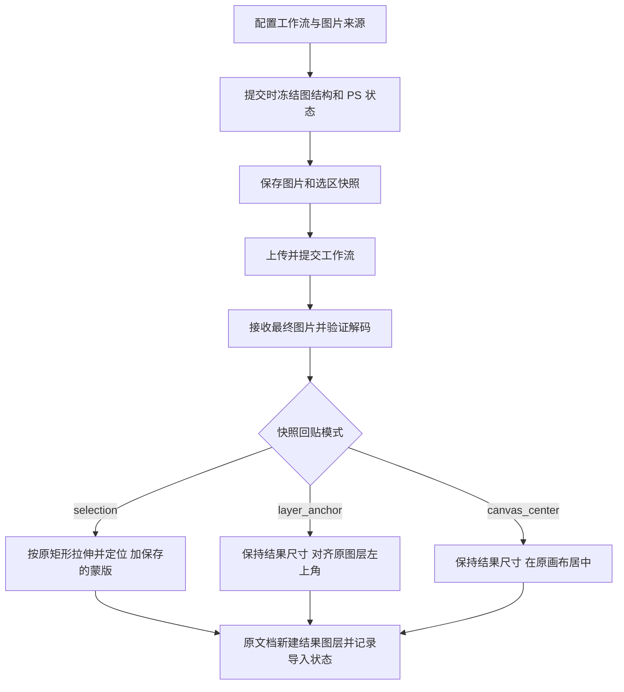

# Photoshop 图片工作流输入与结果回贴实施计划

项目：`/Users/apple/Documents/github/rh-workflow-ps`\
整理日期：2026-10-09（Asia/Shanghai）\
状态：代码实施完成；本地、浏览器及全部 15 项 Photoshop 图像自检通过，已观察真实浮动面板和实际画布拖放。窄面板及部分弹窗的原生视觉仍单独保留待验收。详见 [本轮验收记录](photoshop-image-workflow-verification.md)。

追加修复：透明 PNG 按目标工程的 8/16/32 位深写入，保留图像透明通道；原生自检扩展为 11 项。参考任务 `task_814dda832597` 已在三种位深以及与原工程相同的 16 位 Display P3 临时工程中逐像素验证，透明度、可见颜色和位置均正确，原文件及已有图层保留。

捕获预览追加修复：先按工程原生位深读取，再在插件中转换为预览 PNG，避免 16/32 位工程请求 8 位读取时的 Photoshop `-32005`。当前工程选区预览及三种位深的完整图层、选区图像、蒙版 PNG 均已通过原生验证。

预览复用与返回图层追加修复：工程历史状态一致时，预览与提交复用图片和选区蒙版的不可变文件；内容或选区变化时刷新。自动、手动与拖放共用的导入逻辑直接创建以提示词命名的顶层图层，不创建组；活动来源位于已有组内时也保持此规则。最终确认失败可按写入记录恢复，避免重复创建。

2026-10-09 更新：以本次用户要求为准。取消“图片来源”下拉框，普通图片默认取工程图层，并根据提交时是否有选区自动切换局部/完整图像；增加固定使用选区蒙版的 `LoadImageMask`；任务完成默认回贴原工程；成片右键“导入项目”选择已打开工程，拖出成片卡片导入当前工程。下拉框统一 40px，修复工作流删除和捕获提示，自动归类按 PSD 名称建项目。

## 1. 目标与范围

建立完整的“Photoshop → 工作流 → Photoshop”图片处理链路：在插件中配置工作流，默认读取工程图层，提交任务，接收最终图片，并按提交时保存的规则自动回贴到原工程。

业务界面继续沿用 Desk 的组件、布局和视觉样式，在真正的浏览器 WebView 中渲染。UXP 负责 Photoshop 文档、图层、选区、文件选择及图像回贴，不承担业务界面的重新实现。

本次范围包括：

- 无图片输入节点的工作流。
- 一个或多个图片输入节点的工作流。
- Load Image / LoadImageMask 节点的新增、删除、连接校验和图层绑定。
- 完整图层、选区图像、选区蒙版及本地图片输入。
- 提交快照、最终图片接收、自动回贴、手动选择和失败恢复。
- 成片级位置与蒙版持久化，以及成片页面右键“导入项目”和拖入画布。
- 输入绑定的保存、任务历史以及实际 Photoshop 验收。

本次工作流输入只支持图片，不扩展音频、视频等媒体输入。提示词工坊、专注模式和 Telegram 入站继续保持禁用；工作流本身的提示词和参数编辑保留。共享 Desk 模块中的其他功能不在本计划中重写。

所有实现均在本项目内进行，不修改 `rh-workflow-desk`。使用本项目自己的 `data/` 和本地服务，不自动复制其他项目的凭证、数据库或用户素材。

## 2. 已确认的产品规则

本节记录用户已经确定的行为。后续开发不得将这些规则替换成其他默认值。

| 编号 | 场景或问题 | 已确认规则 |
| --- | --- | --- |
| R1 | 无图片输入节点，提交时没有选区 | 配置参数后直接提交；将返回图片作为新图层加入原工程 |
| R2 | 无选区时上传 Photoshop 图层 | 按所选图层自身的像素边界导出，不补齐为整张画布 |
| R3 | 无选区时返回图片尺寸 | 保持返回图片的实际像素尺寸，不缩放到输入图层或画布尺寸 |
| R4 | 无选区、有图层输入时的结果定位 | 对齐一个指定输入图层在提交时的原左上角 |
| R5 | 无选区、多图层输入时的结果定位 | 可以选择定位图层；所有结果使用该次任务保存的定位规则 |
| R6 | 无选区、没有 Photoshop 图层定位来源 | 返回图片按实际像素尺寸居中放入画布 |
| R7 | 存在选区 | 自动按选区回贴，不依赖 Load Image 是否选择选区来源 |
| R8 | “选区图像” | 上传提交时活动图层在选区外接矩形内的矩形裁剪图像 |
| R9 | “选区蒙版” | 上传与外接矩形大小相同的黑底白色选中图像；保留选区羽化和抗锯齿灰度 |
| R10 | 选区模式的结果尺寸 | 理论上与输入矩形一致；不一致时拉伸到原矩形宽高 |
| R11 | 选区模式的结果定位 | 放回提交时保存的外接矩形位置 |
| R12 | 选区模式的结果蒙版 | 将提交时保存的选区蒙版作为返回图片图层的蒙版 |
| R13 | 多图片工作流编辑 | 可以新增 Load Image，也可以删除图片输入节点 |
| R14 | 有选区的成片保存 | 在保存输出图片的同时，长期保存原矩形位置与尺寸，并额外保存一张原选区蒙版图片 |
| R15 | 成片页面操作 | 在图片成片的右键展开面板提供“导入项目”，选择一个已打开的 Photoshop 工程并导入所选成片 |
| R16 | 有选区成片的再次导入 | 从成片自身保存的信息恢复原位置、尺寸规则及图层蒙版，不使用导入时的当前选区替代 |
| R17 | 图片来源 | 不提供来源下拉框；普通图片默认读取工程图层，有选区自动读取活动图层选区矩形，无选区读取图层自身完整边界；本地图片使用独立按钮切换 |
| R18 | 蒙版节点 | `LoadImageMask` 固定使用“选区蒙版”；必须有活动图层和选区，不可切换本地图片或普通图层图像 |
| R19 | 完成任务 | 所有最终图片默认直接作为顶层新图层加入提交时的原工程，不创建组；图层名称使用任务提示词；原文档关闭时保留成片等待手动选择 |
| R20 | 成片卡片拖动 | 从 Photoshop WebView 成片页拖到 PS 画布，导入当前工程；使用成片自己的坐标与真实图层蒙版 |
| R21 | 控件与提示 | 单行下拉框统一 40px；捕获提示复用 Desk toast 组件 |
| R22 | 工作流删除 | 使用浏览器内 HTML 确认窗口，在 WebView 中执行删除；不依赖原生 `window.confirm` |
| R23 | 项目自动归类 | A.psd 提交的任务归类到 A 项目；用户显式选择项目优先 |
| R24 | 预览与提交 | 工程、历史状态、活动图层和选区一致时复用已经捕获的图片与蒙版文件，不重复传输 PNG；变化或文件失效时重新捕获 |

**选区规则具有最高优先级。** 即使工作流没有任何图片输入节点，只要提交时存在选区，也必须记录选区外接矩形和蒙版，结果按 R7、R10、R11、R12 回贴。

“输入导出范围”“输出像素尺寸”“输出放置位置”是三个独立属性：图层自身边界决定上传内容，返回文件决定无选区结果尺寸，定位图层只决定结果左上角。

### 2.1 三类主要用户流程

| 流程 | 提交 | 接收与回贴 |
| --- | --- | --- |
| 无输入、无选区 | 选择工作流，配置提示词及其他参数，保存目标文档并提交 | 保持结果原尺寸，在原文档居中创建新图层 |
| 多图片输入、无选区 | 独立选择各 Load Image 的图层或本地图片；选择定位图层并提交 | 保持结果原尺寸，对齐定位图层快照左上角；无定位图层时居中 |
| 存在选区 | 普通 PS 图片自动使用活动图层的选区图像，蒙版节点使用选区蒙版；本地参考图可通过按钮选择；始终保存选区快照 | 结果必要时拉伸至原矩形，放回原位置，并添加保存的选区蒙版 |

例如：定位图层提交时的边界为 `(100, 200, 300, 400)`，上传图片为 `200 × 200`。若无选区结果为 `512 × 768`，则以 `512 × 768` 原尺寸放在 `(100, 200)`，不能缩小成 `200 × 200`。

## 3. 实施前基线与现已补齐的差距

下表和编号清单保留实施前的基线。差距已经在本轮代码中补齐，实际 Photoshop 验收仍按末尾矩阵逐项记录；旧版 64×32 自检不能代替新规则的验收。

| 模块 | 可复用能力 | 本计划需要补齐或改变的内容 |
| --- | --- | --- |
| [plugin/host.js](/Users/apple/Documents/github/rh-workflow-ps/plugin/host.js) | 文档和图层枚举、图层像素读取、选区读取、捕获及回贴 RPC | 空输入也捕获选区；回贴方式独立于输入模式；自动接收、原文档定位、尺寸分支、蒙版与失败恢复 |
| [static/ps-webview.js](/Users/apple/Documents/github/rh-workflow-ps/static/ps-webview.js) | 图片来源控件、捕获预览、提交前捕获、手动回贴入口 | 来源名称与可用状态、持久化绑定、定位图层选择、自动回贴设置及状态反馈 |
| [static/app.js](/Users/apple/Documents/github/rh-workflow-ps/static/app.js) | Desk 工作流输入卡片、节点增删、工作流分析及提交 | 图片类型限定、PS 来源接入、图连接校验和任务快照传递 |
| [static/outputs.html](/Users/apple/Documents/github/rh-workflow-ps/static/outputs.html) 与 [static/outputs.js](/Users/apple/Documents/github/rh-workflow-ps/static/outputs.js) | 成片卡片、右键操作面板、导入媒体和文件管理 | 新增 Photoshop“导入”动作；读取成片位置及蒙版；处理附属文件与手动导入记录 |
| [backend/photoshop.py](/Users/apple/Documents/github/rh-workflow-ps/backend/photoshop.py) | PNG 捕获保存、坐标验证、结果像素准备、蒙版读取、导入记录 | 独立的 placement 配置、选区优先、版本兼容及稳定产物身份 |
| [backend/server.py](/Users/apple/Documents/github/rh-workflow-ps/backend/server.py) | 捕获、工作流 PS 配置、结果像素和导入状态接口 | 新快照字段、图连接验证、任务产物状态及并发回贴协调 |
| [scripts/sync-desk-ui.py](/Users/apple/Documents/github/rh-workflow-ps/scripts/sync-desk-ui.py) | 同步 Desk 前端并重复应用宿主钩子 | 将新增钩子纳入同步流程，防止同步后丢失集成 |

整理时源码中的重点差距：

1. `captureInputs()` 在没有 PS 图片绑定时直接返回文档信息，无法满足“零图片输入但存在选区也按选区回贴”。
2. 捕获后端使用某个输入的 `rect` 派生 `placement_rect`，回贴又根据该矩形决定目标宽高。这会把“定位图层”与“缩放到输入大小”混在一起，需要拆开。
3. 现有图片来源为完整/局部图层和完整/局部蒙版；计划需落实明确的“指定图层”“选区图像”“选区蒙版”语义。
4. 当前结果主要通过工作区手动放入当前文档；新流程默认按任务快照回到提交时的文档。
5. Desk 的新增输入自动连线针对特定节点适配，不能假定任意新增 Load Image 都会参与生成。
6. 当前以文件列表索引定位产物。需要防止筛选图片后索引变化导致回贴了另一张文件。
7. 局部蒙版不能只写一个局部矩形便假设其他区域为黑；必须显式保证整张图层蒙版的矩形外区域隐藏。
8. 成片现有右键“导入媒体”调用工作流输入导入窗口，不能直接把文案改成“导入”就当作 Photoshop 图层导入。新增入口需要调用原生宿主桥。
9. 捕获快照中的选区文件不能作为成片唯一的长期蒙版来源；需要形成成片自己的持久化附件与位置记录。

## 4. 交互设计

### 4.1 图片输入卡片

沿用 Desk 卡片样式，取消图片来源下拉框。卡片以文字显示当前规则，并保留图层选择、捕获预览和删除按钮：

| 节点或状态 | 行为 |
| --- | --- |
| LoadImage，无选区 | 默认当前活动图层，可指定图层；按该图层自身像素边界导出 |
| LoadImage，有选区 | 自动使用提交时活动图层的选区矩形，图层选择暂时禁用 |
| LoadImage，点击“使用本地图片” | 选择本地文件，提交时复制成独立快照；点击“使用 Photoshop 图层”恢复默认 |
| LoadImageMask | 固定展示“选区蒙版”；要求活动图层和选区，不提供本地文件按钮 |

重名图层用分组路径和 ID 辅助区分。固定图层绑定使用文档实例、会话和图层 ID；PS 重启或文档变化后不按同名自动绑定。预览保存不可变快照；提交时在同一个原生操作中核对工程历史、图层、选区和绑定，状态一致则复用图片文件，变化后重新捕获。

没有选区时，普通图片自动变成完整图层；蒙版节点阻止提交并说明必须建立活动图层选区。

新增蒙版节点保持用户提供的结构，节点 ID 可按草稿生成：

```json
"543": {
  "inputs": {"image": "undefined", "channel": "red"},
  "class_type": "LoadImageMask",
  "_meta": {"title": "Load Image (as Mask)"}
}
```

### 4.2 定位信息

提交区展示本次预计回贴方式：

- 无选区、有 PS 图层输入：选择“定位图层”；单一可用来源默认使用该图层，多个来源时允许指定。
- 无选区、没有可用 PS 图层来源：显示“保持结果原尺寸，居中放入原文档”。本地文件自身不能提供 PS 文档坐标。
- 存在选区：显示“按当前选区回贴”，以及矩形位置和大小。此时定位图层控件不参与计算。

定位来源保存到工作流配置；本次实际坐标保存到任务快照。用户删掉定位节点后必须重新选择有效来源，不能继续使用旧坐标。

### 4.3 任务结果

计划默认自动回贴最终图片，保留单张选择、手动回贴和失败重试入口。

每张最终图片直接新建顶层图层，不创建任务分组，也不替换原始输入图层。图层名称使用任务中非空的正向提示词，多段以空格连接，换行转为空格；没有提示词时使用任务名称、工作流名称或“成片”。保存实际文档、图层 ID 和写入完成记录以处理重试；同名提示词不会混淆不同产物。

界面应明确区分“工作流完成”“图片已下载”“等待回贴”“已回贴”“回贴失败”“等待选择目标文档”。中间预览、日志及非图片附件不自动作为结果图层。

### 4.4 成片页面右键“导入项目”

用户在成片页面右键点击一张输出图片，展开现有操作面板，其中提供“导入项目”。入口绑定成片的稳定身份，只导入所选图片。

该操作打开工程选择窗口，列出所有已打开的 Photoshop 文档，默认选中当前活动工程。没有打开工程时提示先打开目标；浏览器预览中提示在 Photoshop 面板执行。

导入行为：

- 成片保存了选区信息：读取成片自身的矩形和蒙版，必要时按矩形宽高拉伸结果，并恢复位置和图层蒙版。当前选区的有无、形状及位置均不参与计算。
- 成片保存了无选区的图层定位信息：保持返回图像原尺寸，按保存的左上角导入。
- 成片没有 PS 位置及蒙版信息：以图片实际尺寸居中导入当前工程。
- 有原文档几何信息且当前工程尺寸不匹配：提示核对，沿用 `needs_review` 策略，不能擅自按比例改写原坐标。
- 元数据声明存在蒙版，但蒙版缺失或损坏：明确提示错误，不静默变成无蒙版导入。

既有“导入媒体”如果仍保留，应清楚区分“导入工作流输入”用途；新增“导入”明确表示导入 PS 工程，不能沿用旧动作的处理器。

一次点击产生一次导入请求，处理期间按钮禁用并反馈状态。同一请求的重复事件或网络重试只创建一份图层。用户之后再次明确点击“导入”属于新的手动操作，允许创建新图层或导入另一个工程，不被过去的自动回贴记录阻止。

### 4.5 拖入 Photoshop 画布

图片成片卡片可拖动。WebView 内部拖放保留原有操作；拖出面板到 Photoshop 时，通过宿主桥读取当前目标工程，并使用与“导入项目”相同的成片附件与导入算法。拖动载荷只含任务和成片身份，防止直接打开 PNG 时丢失真实图层蒙版。

取消拖动或留在 WebView 内不会导入。不同画布尺寸时打开工程核对窗口。已检测到 5 次真实外部拖放生成图层，位置与保存的矩形一致。原生自检逐像素核对保存蒙版；取消拖动、内部拖动和不同画布的分支另有浏览器事件检查，尚未全部执行物理操作。

## 5. 工作流节点编辑与输入验证

### 5.1 新增 Load Image

1. 生成不冲突的节点 ID，创建图片 Load Image 节点并加入草稿。
2. 同步新增输入卡片、输入配置和 PS 来源绑定。
3. 保留既有、已知可靠的图像工作流连接适配器；不使用音频或视频连接适配器。
4. 存在唯一、已知兼容的空槽位时可自动连接；多个候选时展示下游节点、字段和连接用途供选择。
5. 没有可靠候选时显示“未连接”。未连接节点不计作有效生成输入，不因卡片存在就宣称它已参与工作流。
6. 再次分析并展示实际连接状态；保护已有参考图顺序，不覆盖已有连线。

### 5.2 删除图片节点

删除作用于工作流草稿，不删除 Photoshop 图层或本地原文件。同步清理该节点的下游连接、输入配置、来源绑定、预览和定位引用。

不能把删除操作简单等同于原来的旁路开关。删除后重新检查下游必填字段；如果形成无效图结构，应阻止提交并指出缺少的连接。工作流保存沿用现有显式保存流程。

### 5.3 提交前校验

- 分析最终要提交的图，而非仅分析旧登记文件。
- 检查所有保留的必填图片输入，包括界面手动配置遗漏的节点。
- 检查图片是否存在、是否能解码、图层是否有效、选区来源是否可用。
- 检查新增节点是否接入、删除节点是否造成悬空连接、图片/蒙版输出类型是否匹配下游。
- 确保本地文件先进入上传流程；不能把本机绝对路径直接作为远程节点输入。
- 没有图片输入节点不是错误；可以仅凭参数运行。

## 6. 像素捕获与坐标约定

所有矩形使用文档像素坐标，与 Photoshop 的显示缩放比例无关。矩形为左闭右开、上闭下开：

```text
R = { left, top, right, bottom }
width  = right - left
height = bottom - top
```

统一在捕获边界计算时向外取整，避免遗漏边缘像素。尺寸必须为正数。图层位置允许为负或超出画布，不能为方便回贴而擅自改变原坐标。

### 6.1 无选区的图层输入

读取图层自身像素边界内的图像。保留矩形内部透明像素；不补成画布大小，也不使用整份文档的合成图代替指定图层。

记录图层实际边界和导出宽高。遇到空图层时明确报错。Photoshop 返回的实际像素范围若小于请求范围，需要按实际 `sourceBounds` 对齐并补透明，避免源坐标与文件坐标混淆。

计划使用 8 位 sRGB PNG 作为工作流传输副本，保留 Alpha。原 PSD 的位深和色彩配置不因此改变。智能对象、文字、分组等来源需在实际 PS 中验证读取表现；不支持的来源应给出明确提示，不能自动栅格化或修改原图层。

### 6.2 选区图像

按实际选区及其返回像素坐标确定外接矩形 R，包含可读取的羽化边缘，并处理画布边界。不能以图层边界替代 R，也不能把矩形缩为“选区与图层不透明区域的交集”。

读取提交时活动图层在 R 内的完整矩形像素。图像不预先按不规则选区挖空，保留矩形中的上下文；原图层自身透明度仍保留。R 中没有图层像素的位置补透明，最终文件始终为 `R.width × R.height`。

### 6.3 选区蒙版

通过 Photoshop 选区像素获取灰度覆盖率，得到与 R 一致的矩形蒙版 S：

```text
S = 0     未选中，黑色
S = 255   完全选中，白色
0 < S < 255   羽化或抗锯齿边缘
```

选区蒙版代表文档选区，不能用图层亮度、图层 Alpha 或该图层已有蒙版冒充。不要按蚂蚁线或 50% 阈值把柔和边缘强制二值化。

同一次捕获的多个“选区图像”或“选区蒙版”输入复用同一份捕获结果。选区蒙版来源无需依赖活动图层是否为空。

### 6.4 上传蒙版的适配

原始选区 S 以灰度 PNG 单独保存，并用于预览和 PS 回贴。工作流上传副本按实际节点读法适配：

| 工作流消费方式 | 适配要求 |
| --- | --- |
| 将黑白图作为 IMAGE 消费 | 图片颜色表达 S，黑底白选中 |
| IMAGE 经灰度通道转换为 MASK | 确认通道和极性，转换结果应等于 S |
| LoadImageMask，channel 为 red/green/blue | 上传 RGB 各通道均为 S，输出 MASK 为 `S / 255` |
| LoadImageMask，channel 为 alpha | 该通道按反向 Alpha 读取；上传副本设 `Alpha = 255 - S`，输出 MASK 为 `S / 255` |
| 自定义蒙版读取节点 | 使用明确的适配器验证，不能只凭节点名称猜测行为 |

本轮专门使用 `LoadImageMask` 加载选区蒙版，默认 channel 为 red。原始 S 和预览保持灰度，只有上传副本进行通道适配；普通 LoadImage 的现有 Alpha 语义保留。

验收时同时检查 IMAGE 和 MASK 两路，防止出现全黑、反向、尺寸错误或预览正常但模型读取错误。

## 7. 提交快照与状态模型

### 7.1 捕获时机

点击提交后先冻结工作流草稿和来源配置，再在一次受控原生操作中读取文档、活动图层、选区和所有 PS 输入。防止用户切换图层或选区造成同一任务混合不同时间的状态。

预览捕获本身不创建生成任务。提交核对原生状态后复用有效快照；无法读取历史状态、绑定变化、工程内容变化或快照文件失效时重新捕获。捕获失败不进入远程提交；已经产生的未关联临时文件应按本项目自己的生命周期管理，不误删原始素材。

本地图片同样复制到本任务独立快照中，避免生成或重试期间原文件被覆盖。

### 7.2 工作流配置与任务快照分离

- 工作流配置保存来源类型、固定图层选择、动态活动图层选项及定位来源。
- 任务快照保存本次解析出来的真实身份、图片文件、选区、坐标及尺寸规则。
- 历史重试使用保存的快照；重新读取当前 PS 内容属于一次新的提交。
- 跨文档或 PS 重启后，旧图层 ID 不能自动按同名重绑定；由用户重新指定。

建议扩展 `photoshop_context` 为版本 2，以下为示意结构，字段名可在实施中调整，但语义不可丢失：

```json
{
  "version": 2,
  "capture_id": "ps_capture_example",
  "session_id": "ps_session_example",
  "document_id": "123",
  "document_name": "example.psd",
  "document_width": 1200,
  "document_height": 900,
  "active_layer_id": "45",
  "selection": {
    "present": true,
    "rect": {"left": 30, "top": 40, "right": 94, "bottom": 72},
    "mask_path": "data/photoshop/captures/ps_capture_example/selection.png",
    "width": 64,
    "height": 32
  },
  "placement": {
    "mode": "selection",
    "anchor_input_id": null,
    "anchor_layer_id": null,
    "left": 30,
    "top": 40,
    "size_policy": "stretch_to_selection",
    "mask_policy": "saved_selection"
  },
  "inputs": [],
  "imports": []
}
```

该例刻意使用空 `inputs`，表示“没有图片输入，但有选区”的合法任务。JSON 中的路径是结构示意，实际由服务生成本项目目录内的路径。

### 7.3 定位策略

| 模式 | 触发条件 | 位置 | 输出尺寸 | 图层蒙版 |
| --- | --- | --- | --- | --- |
| `selection` | 提交时有有效选区 | 保存的 R 左上角 | R 的宽高，必要时拉伸 | 保存的 S |
| `layer_anchor` | 无选区，存在定位图层 | 保存的定位图层左上角 | 返回图像实际尺寸 | 不自动添加选区蒙版 |
| `canvas_center` | 无选区，无图层定位来源 | 按保存的画布尺寸计算中心 | 返回图像实际尺寸 | 不自动添加选区蒙版 |

选择模式的优先级固定为 `selection > layer_anchor > canvas_center`。不能继续用“是否存在 placement_rect”决定是否缩放；图层定位坐标不代表目标尺寸。

### 7.4 成片级持久化：输出图片、位置、蒙版

任务快照用于保证本次生成可重试；成片信息用于长期浏览、再次导入及跨会话使用。两者不能只靠一个临时路径关联。

有选区时，每一张最终输出图片在进入成片库时同时形成以下持久化内容：

| 内容 | 要求 |
| --- | --- |
| 输出图片 | 保存工作流返回的原始文件，不被回贴拉伸副本覆盖 |
| 选区蒙版图片 | 额外保存一张与原矩形尺寸一致的灰度 PNG，黑底白选中，保留羽化值 |
| 位置及回贴信息 | 保存矩形的 left/top/right/bottom、宽高、尺寸处理规则、原文档尺寸及蒙版关联 |
| 关联身份 | 通过 output_id 或成片稳定 ID 关联，不能仅靠结果文件名猜测是哪张蒙版 |

蒙版直接来自提交时冻结的原始 S，不从返回图片重建，也不在生成完成后重新读取当前 PS 选区。即使第一次自动回贴失败，也应已经保存成片及其导入信息。

建议将一张成片和附属文件组织为可一起移动的资产单元，示意布局：

```text
artifact-<output_id>/
  result.png           # 原始输出图片，实际保留原文件格式
  selection-mask.png   # 有选区时额外保存的原始蒙版
  photoshop.json       # 位置、尺寸策略、来源信息及附件关联
```

目录布局是实施建议，不要求现有成片库全部迁移。也可保留原结果路径并使用附件目录，但资产层必须显式管理它们的关系。

示意成片元数据：

```json
{
  "version": 1,
  "output_id": "output_example",
  "source_task_id": "task_example",
  "image_path": "result.png",
  "source_document": {"width": 1200, "height": 900},
  "placement": {
    "mode": "selection",
    "rect": {"left": 30, "top": 40, "right": 94, "bottom": 72},
    "width": 64,
    "height": 32,
    "size_policy": "stretch_to_selection"
  },
  "selection_mask": {
    "path": "selection-mask.png",
    "width": 64,
    "height": 32,
    "role": "selection_mask"
  }
}
```

示例中的相对路径以资产单元为基准。实际附件位置须位于本项目管理的成片目录，服务校验路径归属、解码尺寸及关联 ID。无选区成片仍保存其定位策略，蒙版字段为空。

生命周期要求：

- 成片的蒙版与位置记录不能只指向 `data/photoshop/captures/` 中可能清理的输入快照，需在发布到成片库前持久化到输出资产侧。
- 一次任务产生多张图片时，每张成片都可独立恢复导入信息。若采用蒙版共享存储，必须有明确引用关系与生命周期，不能因删除一张成片而破坏其他成片。
- 蒙版是辅助图片，不显示成另一张生成结果，不进入自动回贴列表，也不作为普通成片参与默认预览、推送或导出。
- 成片在项目间移动、改名或复制时，位置记录和蒙版附件跟随，引用保持有效；通过项目内可恢复操作删除资产时一并处理附件。
- 原文档关闭、PS 重启、页面刷新或捕获缓存清理后，成片仍具备完整的导入信息。

## 8. 接收图片与回贴算法



### 8.1 接收与产物身份

最终图片必须下载完成并能实际解码，再进入回贴队列。保存原始生成文件，PS 用的解码或缩放副本单独准备，不覆盖原始产物。

发布到成片库时，先保存输出侧的定位记录与蒙版附件，再标记成片可按原规则导入。辅助蒙版不属于最终图片产物，不能因其文件类型也是 PNG 而误加入回贴队列。

优先为产物建立稳定的 `output_id`。兼容现有 `output_index` 时沿用同一份完整文件列表索引；不能先筛选图片再编号，导致 UI、像素接口与导入记录指向不同文件。

自动回贴只处理明确的最终图片产物；中间预览和无法判断用途的附件在结果界面手动选择。多张最终图片按稳定顺序各自创建顶层图层，使用任务提示词命名。

### 8.2 无选区、有定位图层

```text
outputWidth  = decodedImage.width
outputHeight = decodedImage.height
targetLeft   = savedAnchor.left
targetTop    = savedAnchor.top
```

不因输出比输入大或小而缩放、裁切或重新居中。源图层在等待期间被移动、改名或删除，不改变已经冻结的坐标；目标文档仍须通过安全匹配。

### 8.3 无选区、无定位图层

```text
targetLeft = round((savedCanvasWidth  - outputWidth)  / 2)
targetTop  = round((savedCanvasHeight - outputHeight) / 2)
```

输出保持实际像素尺寸。超过画布的图片可以产生负坐标；不为了完整显示而自动缩小。

### 8.4 有选区

1. 从任务快照读取 R 和 S，不读取当前选区。
2. 校验蒙版尺寸与 R 一致。
3. 返回图像尺寸等于 R 时不缩放；不等时分别按 R 的宽、高拉伸，允许改变长宽比。
4. 在原文档创建新像素图层，将图像左上角放到 `(R.left, R.top)`。
5. 创建全画布黑底图层蒙版，再把 S 写入 R。矩形外区域必须保持隐藏。
6. 保留图片自己的 Alpha，最终显示由图片 Alpha 与图层蒙版共同决定。
7. 不把蒙版破坏性应用到像素，不替换源图层，不改变文档当前选区来模拟蒙版。

蒙版写入可使用先创建“隐藏全部”用户蒙版、再在 R 写入灰度的方式；具体命令须在实际 PS 验证。不能假定局部 `putLayerMask` 覆盖操作天然让未写入区域变黑。

### 8.5 原文档与撤销

自动回贴使用提交时的文档实例和会话记录，而不是回贴时碰巧激活的文档。切换到另一文档不改变目标。

每次结果图层及其蒙版创建作为明确的 Photoshop 历史操作，可撤销。失败时清理本次创建的不完整结果，原始图层和已经成功导入的其他结果保留。尽量恢复回贴前用户的活动文档、活动图层和选区状态。

## 9. 导入状态、并发及异常处理

使用 `(task_id, output_id)` 作为导入身份，兼容旧任务时保留原始产物索引。导入状态与任务生成状态分开保存。

此身份用于同一产物的自动回贴。成片页明确触发的手动导入另建 `(output_id, import_request_id)` 记录，包含目标工程、图层 ID、实际使用的定位信息、时间及状态；同一请求幂等，新的点击可以再次导入。不能清空或覆盖原任务的导入记录来实现手动导入。

| 状态 | 含义 | 后续处理 |
| --- | --- | --- |
| `pending` | 图片已准备，等待回贴 | 自动队列认领 |
| `importing` | 已认领，原生操作处理中 | 避免并行重复执行 |
| `imported` | 像素、蒙版及状态均已确认 | 重复通知不再创建图层 |
| `failed` | 回贴过程失败 | 显示原因，允许针对该产物重试 |
| `needs_document` | 原文档关闭或会话身份失效 | 等待用户指定目标 |
| `needs_review` | 画布几何变化或中断后结果身份不明确 | 保留图片，等待核对；该状态为计划新增 |

并发约束：

- 后端认领和持久化配合原生串行队列，不能只依靠一个页面的内存开关。
- Photoshop 暂时处于模态操作时排队或退避，不把暂时忙碌当成生成失败。
- 像素和蒙版写入成功后，由认领者先记录文档、图层 ID 和 `write_complete`，再使用提示词命名并确认完成。最终状态保存失败时按已完成的图层 ID 恢复，不能直接再建图层。
- 插件重载后重新协调导入状态；不能仅凭另一个文档中的同名图层确认成功。
- 用户撤销或删除已导入结果后，不因轮询或刷新自动重建。再次导入只能通过明确的手动操作。

异常行为：

| 条件 | 预期处理 |
| --- | --- |
| 没有打开的 PS 工程 | 首版提交前提示打开目标工程；不悄悄创建文档代替用户指定工程 |
| 指定输入图层在提交前删除 | 提示重新选择，不按同名自动替代 |
| 输入图层为空或不能读取 | 在捕获阶段指出对应输入，不提交错误文件 |
| 选区输入仍被选择，但提交时已无选区 | 阻止提交并提示修正来源 |
| 等待期间取消、改变选区或切换活动图层 | 使用原快照回贴 |
| 等待期间关闭原文档 | 保存结果，进入 `needs_document` |
| 原文档在等待期间缩放或裁切画布 | 暂停自动回贴，核对几何；不只根据旧坐标盲贴 |
| PS 重启或原文档重新打开，身份发生变化 | 不复用旧内存 ID 自动回贴；需要重新指定并核对尺寸 |
| 结果损坏、下载不完整 | 不创建图层，区分接收失败与回贴失败 |
| 重复完成通知、刷新、多面板或重试 | 同一个产物只自动导入一次 |
| 多张图片中一张回贴失败 | 保留其他成功结果，单独重试失败项 |
| 成片有位置记录但蒙版附件丢失 | 说明附件缺失，不默默去掉蒙版或读取当前选区替代 |
| 成片页右键导入到另一个尺寸不匹配的工程 | 暂停并提示核对，保留原始位置和蒙版 |
| 普通旧成片没有 PS 元数据 | 仍可作为原尺寸图片居中导入，清楚标识其没有原位置和蒙版信息 |

上述异常策略是实施默认建议。若后续需要在没有工程时自动新建文档，应另行扩展，不影响本次已确认的定位和尺寸规则。

## 10. 模块职责与接口演进

| 层 | 职责 | 不应承担的职责 |
| --- | --- | --- |
| WebView | 工作流配置、输入来源、预览、定位选择、任务反馈 | 直接读取 Photoshop DOM、随意执行宿主 JavaScript |
| UXP 宿主桥 | 解析文档/图层身份、一次性捕获、串行回贴、原生历史操作 | 重新实现 Desk 业务界面、凭当前选区猜测旧任务 |
| 本地服务 | 保存快照、上传与任务编排、产物校验、尺寸处理、导入状态 | 改动原 PSD、将本地路径直接当远程上传文件名 |

优先演进已有 RPC 和 HTTP 接口，不创建平行的第二套任务系统：

- `runtime`：补充选择状态、选区可用性和图层来源信息。
- `captureInputs`：接受来源绑定及定位配置，即使 `inputs=[]` 也读取选区并生成快照。
- `importOutput`：默认按保存的 placement 执行，手动目标重绑定为独立显式操作；不能通过清空 imports 丢弃已有导入身份。
- `/api/photoshop/captures`：接受版本化快照并验证图片、蒙版、矩形一致性。
- 工作流 PS 配置接口：保存图片来源及定位选择，保留与 Desk 输入配置的映射。
- 结果像素接口：按 placement 的尺寸策略准备副本，使用稳定产物身份。
- 导入状态接口：支持认领、恢复及新增状态，并保留幂等保护。
- 成片列表及详情接口：为图片返回位置/蒙版是否可用、稳定资产身份及导入元数据；辅助蒙版不进入普通成片列表。
- 成片移动、改名、复制及删除流程：按输出图片与其附件的资产关联一起处理。
- 成片页 PS 导入桥：通过明确的成片 ID、导入请求 ID 和当前目标文档调用原生操作，不复用“导入工作流输入”的接口。

桥接维持 JSON 请求 ID、超时、方法白名单及来源校验。宿主像素直接落本地快照，WebView 主要接收路径、尺寸和缩略图，避免经页面消息重复搬运大型像素数组。

保持共享 `static/app.css` 和 Desk 结构。新增逻辑集中在宿主桥、PS 集成 JS/CSS 和同步脚本钩子；每个实施阶段确认同步 Desk 后仍可重复得到同样集成。

旧版 `photoshop_context` 应按版本读取。缺少明确的定位、蒙版或目标身份时，给出人工回贴入口，不把旧任务静默解释成已经满足新规则。

## 11. 分阶段实施与完成条件

`[x]` 表示代码与对应本地检查已完成；实际 Photoshop 完成条件单独记录，不以勾选代替原生验收。

### 阶段 A：无输入工作流闭环

- [x] 明确并落库独立的 placement 策略。
- [x] 零图片输入任务记录目标文档，并检查是否存在选区。
- [x] 接收并解码最终图片，保留原始产物。
- [x] 无选区结果按实际像素尺寸居中，直接创建以提示词命名的顶层结果图层。
- [x] 保存导入状态，验证重复通知不重复导入。

完成条件：在实际 PS 中验证无输入、无选区工作流从任务创建到结果图层的本地完整链路；暂用模拟结果，不发起付费生成。

### 阶段 B：多图片、无选区

- [x] 取消图片来源下拉框；支持动态活动图层、指定图层及本地图片按钮。
- [x] 按图层自身边界导出，记录坐标并保留内部透明像素。
- [x] 增删 Load Image，保持配置同步并校验下游连接。
- [x] 多图输入支持定位图层选择和来源持久化。
- [x] 返回结果原尺寸对齐指定图层左上角。
- [x] 固定来源按文档/会话/图层 ID 绑定；提交时检测失效图层及遗漏输入。

完成条件：两张以上输入可以独立配置，增删后图结构有效，输入尺寸及不同尺寸结果定位均符合 R2—R6。

### 阶段 C：选区与蒙版

- [x] 自动检测选区图像；新增 LoadImageMask，固定使用活动图层选区蒙版。
- [x] 一次捕获活动图层裁剪、原始选区灰度和矩形。
- [x] 适配实际工作流的 IMAGE/MASK 读取方式。
- [x] 任何存在选区的任务都选择 `selection` placement，包括零图片输入任务。
- [x] 返回尺寸不一致时拉伸到原矩形。
- [x] 建立矩形外为黑的完整结果图层蒙版，并写入保存的灰度。
- [x] 在实际 PS 取消及更改当前选区后，仍恢复原 R/S；包括 377×611 大尺寸灰度蒙版。
- [x] 每张有选区的成片长期保存位置元数据和额外蒙版图片，并排除辅助蒙版的普通成片展示。

完成条件：不规则、带羽化及超出源图层边界的选区都能按原位置回贴，遮罩极性、灰度、尺寸和矩形外区域正确；成片的蒙版和位置可脱离输入捕获缓存长期使用。

### 阶段 D：恢复与回归

- [x] 多结果、并行任务和 PS 模态忙碌时正确排队。
- [x] 支持失败重试、面板刷新、插件重载和导入中断恢复。
- [x] 原文档关闭、身份改变或画布几何改变时暂停并给出清楚入口。
- [x] 用户撤销后不自动重建结果。
- [x] 校验历史快照重试与“重新读取当前状态提交”的区别。
- [x] 验证同步 Desk 不覆盖集成，检查浏览器 320/460/900px 布局。
- [x] 观察实际 Photoshop WebView 浮动面板的普通图片、固定选区蒙版及成片页面。
- [ ] 在实际 Photoshop 复验窄面板、删除确认框、导入工程窗口和右下角 toast；对应浏览器检查通过。
- [x] 成片右键面板提供“导入项目”，调用 PS 桥并从资产元数据恢复位置与蒙版。
- [x] 手动导入使用独立请求身份，允许跨会话或再次导入而不破坏自动回贴记录。
- [x] 成片改名、项目归类后，其蒙版和位置关联仍有效。
- [x] 观察实际画布拖入成片、新图层位置和蒙版存在；已编辑的用户蒙版不作为逐像素测试样本。
- [x] 修复后的 /lab?autorun=1 全部 8 项通过，记录原生结果；合成蒙版逐像素复验通过。

完成条件：没有重复图层、错误文档回贴、旧选区丢失或同步后功能消失；验收记录说明各项实际测试范围。

## 12. 验收矩阵

| 编号 | 测试场景 | 通过条件 |
| --- | --- | --- |
| T01 | 无输入、无选区；画布 `300×200`，结果 `64×32` | 结果尺寸不变，位置为 `(118,84)`，新建图层 |
| T02 | 输入图层边界 `(13,17,46,36)` | 导出为 `33×19`，不补成画布；内部透明像素保留 |
| T03 | T02 的无选区结果为 `66×38` | 返回仍为 `66×38`，左上角为 `(13,17)` |
| T04 | 两张图层输入，选择第二张定位 | 两份独立图片进入正确节点；所有最终结果按第二张的保存位置回贴 |
| T05 | 同名图层处于不同分组 | 按文档/图层 ID 区分，不按名称误选 |
| T06 | 新增或删除输入节点 | 图、配置、预览、定位引用同步；无效必填连接阻止提交 |
| T07 | 有选区 R=`(30,40,94,72)` | 选区图像、蒙版均为 `64×32`，坐标固定 |
| T08 | 选区矩形部分超出活动图层像素范围 | 图像仍为 R 的尺寸，缺失位置透明，蒙版位置不偏移 |
| T09 | 不规则选区和羽化灰度样本 | 保存及回贴保留 `0/80/180/255` 等覆盖率，矩形外黑色 |
| T10 | LoadImageMask red/green/blue/alpha 四种通道读取 | 消费结果的白区含义、极性和尺寸正确，不能只看预览 |
| T11 | 选区结果返回 `128×64`，原 R 为 `64×32` | 拉伸至 `64×32` 后放在 `(30,40)`，使用原 S |
| T12 | 返回长宽比也不同于 R | 按原宽高拉伸，不自动改成等比裁切或留白 |
| T13 | 零图片输入或全部为本地文件，但 PS 有选区 | 仍保存 R/S，并按选区回贴 |
| T14 | 提交后取消选区、改选区或切换活动图层 | 返回使用原 R/S 及原来源快照 |
| T15 | 等待时切换到另一文档 | 结果回到提交时原文档，不贴错当前文档 |
| T16 | 原文档关闭、重新打开或 PS 重启 | 保留产物等待目标确认，不能按旧 ID 误贴 |
| T17 | 等待时修改画布尺寸或裁切 | 自动回贴暂停并提示核对 |
| T18 | 多张结果中一张损坏或回贴失败 | 成功项保留；失败项可独立重试，原文件不被覆盖 |
| T19 | 重复完成通知、刷新、重载或并发回贴 | 每个产物只自动导入一次 |
| T20 | 回贴成功但状态写入中断 | 重试先核对已建图层；不直接增加重复结果 |
| T21 | 用户撤销或删除结果图层 | 轮询不自动重新创建；手动再次导入有明确语义 |
| T22 | 源图层为负坐标或结果大于画布 | 保存原始像素坐标，结果不为适配画布而缩小 |
| T23 | 同步 Desk 前端，再打开 PS 面板 | 图片来源、定位、回贴及排除功能仍符合计划 |
| T24 | 有选区任务产生成片 | 输出原图、额外蒙版 PNG 与位置记录均长期保存；蒙版不成为额外成片卡片 |
| T25 | 捕获缓存清理、PS 重启后打开成片页 | 成片自己的蒙版和位置仍可读取，不依赖旧输入快照路径 |
| T26 | 右键某张图片，点击“导入项目” | 选择已打开的 PS 工程，只把该成片作为新图层导入所选工程，不打开工作流输入导入窗口 |
| T27 | 成片源于旧选区，但当前选区已改变或不存在 | 导入恢复成片保存的原位置与原蒙版，不使用当前选区 |
| T28 | 成片改名、移动或复制到另一项目 | 输出图片、位置及蒙版保持有效关联，导入行为一致 |
| T29 | 一次手动导入重复通知，之后用户再次点击 | 单次请求只建一层；新的明确点击可再次导入，原自动回贴状态保留 |
| T30 | 普通旧成片无元数据，或有元数据但蒙版丢失 | 前者按原尺寸居中导入；后者说明错误，不静默丢弃蒙版 |

验证分层：

1. JS 语法、宿主桥及 Python 数据/HTTP 测试：验证消息、尺寸、状态和坐标规则。
2. 本地工作流模拟：验证提交快照、下载结果和回贴编排；不消耗远程生成额度。
3. 浏览器布局：检查 320/460/900px 下的输入卡片、自动来源提示、图层选择及结果状态。
4. 真实 Photoshop：通过合成测试文档验证捕获和回贴像素，记录 PS/UXP 版本、面板大小与实际结果。
5. 实际远程工作流：后续明确需要时再执行，单独记录；前四层通过不等于远程生成端到端通过。

本轮已执行的检查命令：

```sh
cd /Users/apple/Documents/github/rh-workflow-ps
npm run check
npm run test:bridge
.venv/bin/python -m pytest -q tests
```

原生 `/lab` 的像素往返自检作为基础冒烟检查保留；三类业务场景另需完整验收。

## 13. 交付物与结束标准

计划实施后的交付物应包括：

- 可持续同步 Desk 的 WebView 图片工作流界面。
- 持久化的图片来源、定位配置和版本化任务快照。
- 无输入、多图无选区、有选区三类捕获与回贴流程。
- 正确的蒙版适配、原始产物保留、导入状态及恢复机制。
- 成片级位置记录和额外蒙版图片，以及成片右键“导入”为 PS 图层的完整流程。
- 对应本地测试、实际 PS 验收记录和操作说明。

只有已确认规则、核心验收项和原文档保护同时满足，才可宣称该图片工作流链路完成。插件加载成功、HTTP 返回成功、WebView 显示正常或单独的像素自检通过，都不能代替业务流程验收。

## 14. 技术依据

- [Adobe Photoshop Imaging API](https://developer.adobe.com/photoshop/uxp/2022/ps-reference/media/imaging)：图层及选区像素、实际 sourceBounds、尺寸与坐标、putPixels 和 putLayerMask。
- [Adobe WebView 与消息桥](https://developer.adobe.com/photoshop/uxp/2022/uxp-api/reference-js/global-members/html-elements/html-web-view-element)：原生宿主与浏览器 WebView 的职责和消息通信。
- [ComfyUI 官方 LoadImage 实现](https://raw.githubusercontent.com/Comfy-Org/ComfyUI/master/nodes.py)：IMAGE 与 MASK 输出、反向 Alpha 的蒙版语义。自定义节点及部署版本需单独验证。
- [项目开发约束](/Users/apple/Documents/github/rh-workflow-ps/AGENTS.md)。
- [项目启动与当前方案说明](/Users/apple/Documents/github/rh-workflow-ps/README.md)。
- [Desk 前端样式约定](/Users/apple/Documents/github/rh-workflow-ps/docs/desk-frontend-style.md)。

本节为实现依据，不改变第 2 节已经确认的产品行为。
